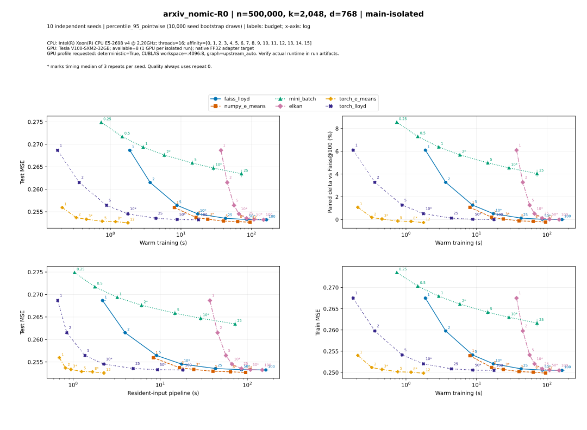

# e-means 検証結果

**実データの厳しい品質水準では、e-meansの観測到達時間が短い条件が多かった。** V100上の条件を揃えた比較では、Faiss Lloyd 100反復のtest MSEに対する平均差が0.1〜2%以内の各水準で、全10条件の観測到達時間がTorch Lloydより短かった。10%水準まで広げるとTorch Lloydが短い実データ条件も4つあった。CPUでは、実データの厳しい品質水準でNumPy e-meansが速く、合成データや緩い水準ではMiniBatchとFaiss Lloydの到達時間が短い条件が多かった。

GPUでの効果もデータの形状に依存した。重なりを増やした合成データではe-meansが短い時間で低いMSEに達した。クラスタ当たりの学習データが8件の条件では、同じ0%水準でTorch Lloydが約8分の1のwarm時間だった。時間差には、バッチ単位の更新、中心の再活性化、計算とメモリ処理を含む実装全体の差が表れる。

## 計測と集計

| 対象 | 条件数 | CPU 試行 | GPU 試行 | 完全な曲線の点 |
| --- | ---: | ---: | ---: | ---: |
| arXiv・Landmark | 10 | 3,020 | 1,460 | 400 |
| 合成データ | 12 | 3,400 | 1,640 | 480 |
| 合計 | 22 | 6,420 | 3,100 | 880 |

CPUはXeon E5-2698 v4の1 NUMAノードの16物理コアで、Faiss Lloyd、NumPy e-means、scikit-learn MiniBatch、Elkanを比較した。GPUはV100-SXM2 32 GBの1枚を使い、native FP32のTorch e-meansと同じ割り当てバックエンドを使うTorch Lloydを比較した。GPUは両手法に同じ決定論的な設定を適用した。8枚の同時計測の資格確認では、48組中16組で単独計測から5%以上ずれたため、正式なGPU計時には単独実行を選んだ。[本評価プロトコル](protocol/README.md)

単調時計の記録から、220の条件・seedの組すべてで、CPUはFaiss Lloyd、NumPy e-means、MiniBatch、Elkanの順、GPUはTorch e-means、Torch Lloydの順だったことを確認した。各手法の中では予算、反復番号の昇順で実行した。この固定順は計時差の一因になり得る。順序の影響を特定するには、順序を入れ替えた計測が必要になる。

各条件で分割、FP32の入力と初期中心を共有し、10 seedで各予算点を独立に実行した。品質は最終の中心集合に対する、テスト点ごとの最近傍二乗L2距離の平均を用いた。平均は次元数で割らない。各点の品質はrepeat 0の10 seed平均、時間はseed内の中央値を取った後の10 seed中央値。R0とS0の代表予算点だけに3回計時を行い、図で印を付けた。学習時間は同期を含むwarm学習区間、入力常駐パイプラインは入力が用意された後の実測adapterの呼び出しから、中心を保存してfsyncするまでを含む。データ準備、捨てrun、独立評価には別の記録を使った。

品質水準は、各seedのFaiss Lloyd 100反復に対するtest MSEの相対差を平均して求めた。表の到達時間は指定水準を満たした観測点のうち最小のwarm中央値である。点ごとの95% CIは共通seed indexを使う対応付きbootstrapの10,000回再標本化で得た。速度比はこの実行環境での点推定を記述する。補間なしの7水準と全880点の曲線を比較し、validationで予算を選んだときのtest結果も併記した。

## 実データの品質と速度

arXiv文章埋め込みとLandmark画像埋め込みで、学習件数とクラスタ数を変えた各5条件を評価した。6手法・400予算点の計4,480試行はすべて初回で成功し、各点に10 seed 分の評価が揃った。4,480件には代表点の追加計時を含む。条件図は各手法の試行点を結び、test MSEとwarm学習時間、基準比とwarm学習時間、test MSEと入力常駐パイプライン時間、train MSEとwarm学習時間を示す。

### V100での比較

同じGPU、native FP32の割り当て、共通初期中心を使った比較では、同じseedのFaiss Lloyd 100反復に対する平均test MSE差を0.1〜2%の各水準に置くと、全10条件でe-meansの観測到達時間が短かった。水準を0%にするとe-meansは全10条件で到達し、Torch Lloydは7条件で到達した。残りの3条件はarXivの全量とクラスタ数8,192、Landmarkのクラスタ数8,192だった。0%到達点で点ごとの95% CI上端も0%以下だったのはe-meansが6条件、Torch Lloydが1条件だった。

| 基準比の水準 | GPUでe-meansが短い条件／両手法到達 | GPUの時間比 Lloyd／e-means | CPUでe-meansが短い条件／両手法到達 | CPUの時間比 Faiss／e-means |
| ---: | ---: | ---: | ---: | ---: |
| 0% | 7/7 | 11.20–25.93 | 9/9 | 2.03–10.77 |
| 0.1% | 10/10 | 5.60–42.42 | 10/10 | 1.02–5.63 |
| 0.5% | 10/10 | 3.26–32.91 | 9/10 | 0.78–2.81 |
| 1% | 10/10 | 1.63–13.21 | 6/10 | 0.55–2.28 |
| 2% | 10/10 | 1.63–6.63 | 7/10 | 0.31–1.16 |
| 5% | 8/10 | 0.50–2.66 | 0/10 | 0.15–0.93 |
| 10% | 6/10 | 0.50–1.33 | 0/10 | 0.09–0.48 |

時間比は各条件で観測済みの到達点のうちwarm中央値が最小の点を用いた範囲で、1を超えるとe-meansの時間が短い。未到達の組は比を欠測として保持する。CPUの0%水準ではarXivのクラスタ数256でFaissだけが到達した。水準は曲線を読むための目盛りである。時間比は記述比較として読み、各予算点の時間と損失の不確かさは図の95% CIで確認できる。

arXivの標準条件では0.5%水準にe-meansの2 epochとTorch Lloydの25反復で到達した。warm時間は0.329秒対4.413秒、同じ2点での入力常駐パイプライン時間は0.818秒対4.899秒だった。Torch Lloydの時間をe-meansの時間で割ると、順に約13.4倍と約6.0倍だった。Faiss基準からの平均test MSE差はそれぞれ+0.180%（95% CI +0.135〜+0.223%）と+0.125%（+0.108〜+0.143%）だった。10%水準では両手法が1 epoch・1反復で到達し、Torch Lloydのwarm 0.178秒に対してe-meansは0.208秒だった。このときの平均test MSE差はそれぞれ+6.099%と+1.077%だった。

arXivの小規模条件では5%水準に両手法が1全件相当で到達し、warm時間はTorch Lloyd 0.0367秒、e-means 0.0728秒だった。Landmarkの小規模条件の同水準ではwarm中央値はTorch Lloyd 0.0720秒、e-means 0.0724秒、当該点の入力常駐パイプライン中央値は順に0.2120秒、0.2114秒だった。双方の点ごとの時間CIは重なる。短い計測点では時間の集計範囲も判断に効く。

arXiv標準条件の例では、精度の厳しい側で必要な全件パス数の差が速度差に伴い、1パスの時点ですでにe-meansのtest MSEが低かった。観察した時間差には、バッチ単位の中心更新、学習スケジュール、メモリ処理などの実装全体が寄与する。個別処理の寄与を特定するには、処理を一つずつ変えた比較やカーネルごとの計測が必要になる。

### CPUでの実用比較

CPUの4手法を同じ観測到達時間で比べると、0%・0.1%・0.5%ではNumPy e-meansがそれぞれ10条件中9条件で最短だった。残りの条件は0%と0.1%ではElkan、0.5%ではFaiss Lloydが最短だった。1%ではNumPy e-meansが6条件、Faiss Lloydが4条件。2%ではNumPy e-meansが7条件、MiniBatchが2条件、Faiss Lloydが1条件で最短だった。5%ではFaiss Lloydが6条件、MiniBatchが4条件。10%ではMiniBatchが9条件、Faiss Lloydが1条件で最短だった。NumPy e-meansとFaiss Lloydの2手法に絞ると、5%と10%では全10条件でFaiss Lloydの方が短かった。

CPUのarXiv標準条件では0.5%水準にNumPy e-meansが2 epoch・16.33秒、Faiss Lloydが25反復・42.84秒、Elkanが25反復・85.17秒で到達した。MiniBatchはこの水準に未到達だった。10%水準ではMiniBatchが0.25全件相当pass・0.741秒、Faiss Lloydが1反復・1.884秒。NumPy e-meansは1 epoch・8.061秒で、同じ予算点で約1.075%の基準差だった。

### validationで予算を選んだ場合

validation MSEが最小の点を各条件・各手法から選んだ60組の結果も集計した。NumPyとTorchのe-meansは、arXivのクラスタ数256とLandmarkのクラスタ数256・全量で8 epoch、残る7条件で12 epochが選ばれた。MiniBatchは全10条件で25全件相当passが選ばれ、testの基準差は+0.755〜+4.770%だった。選んだ予算の性能は独立したtest splitで評価した。前節の到達点はtest曲線上での観測である。

## 合成データの品質と速度

12条件・480予算点の計5,040試行がすべて初回で成功し、各点に10 seed 分の評価が揃った。条件は件数、次元数、クラスタ数、クラスタ当たりの件数、重なり、異方性、少数成分、外れ値、厳密な重複と、二つの要因の組み合わせを変えた。各seedでデータ生成と学習に別々の乱数ストリームを使った。合成データの区間は、10組の間でデータを生成し直す変動も含む。[条件表](../plan/design/01-experiment-protocol.md)

| 基準比の水準 | GPUでe-meansが短い条件／両手法到達 | GPUでe-meansだけ到達 | GPUの時間比 Lloyd／e-means | CPUでe-meansが短い条件／両手法到達 |
| ---: | ---: | ---: | ---: | ---: |
| 0% | 2/4 | 8 | 0.12–11.61 | 4/12 |
| 0.1% | 1/4 | 8 | 0.12–5.80 | 0/12 |
| 0.5% | 2/5 | 7 | 0.12–3.52 | 0/12 |
| 1% | 2/5 | 7 | 0.12–4.79 | 0/12 |
| 2% | 1/5 | 7 | 0.12–4.79 | 0/12 |
| 5% | 5/9 | 3 | 0.12–14.06 | 0/12 |
| 10% | 4/12 | 0 | 0.12–5.66 | 0/12 |

合成の標準条件S0では、GPU e-meansの1 epochで基準より平均test MSEが19.77%低く（95% CI −22.77〜−17.12%）、warmは0.0430秒だった。Torch Lloydの曲線の最良点は基準より4.20%高く、0%水準には未到達だった。CPUの0%水準の観測最短値はMiniBatch 0.0725秒、Faiss Lloyd 0.349秒、NumPy e-means 0.512秒だった。CPUのMiniBatchとNumPy e-meansがこの水準に到達した点では、基準からの平均test MSE差はそれぞれ−9.57%、−16.90%だった。

重なりを増やしたSoverlapの0%水準では、GPU e-meansの8 epochで0.0850秒、Torch Lloydの50反復で0.987秒だった。全観測点から数えたseed単位の到達は8/10と6/10で、選ばれた両点の基準差CIはいずれも0%をまたいだ。クラスタ当たり8件のSratioでは1全件相当で両手法が0%水準に到達し、Torch Lloydはwarm 0.00438秒、e-meansは0.0353秒だった。同じ点の入力常駐パイプラインは0.0186秒と0.0413秒だった。クラスタ数を増やしたSkでも、Torch Lloydは0%水準で0.0227秒、e-meansは0.0483秒だった。

CPUでは0%水準でMiniBatchが8条件、Faiss Lloydが3条件、NumPy e-meansが1条件で最短だった。0.1〜1%の各水準はMiniBatchが8条件、Faiss Lloydが4条件で最短。5%水準ではMiniBatchが11条件、10%水準では全12条件で最短だった。実データで厳しい水準の到達が速かったNumPy e-meansと比べ、合成条件ではMiniBatchやFaiss Lloydの優位な領域が広かった。

Torch Lloydは学習時に空になった中心を保持する。Faiss Lloydは中心の分割を記録し、e-meansは上流実装の中心再活性化を用いる。初期中心を共有しても、分布と更新処理によって到達する損失が変わる。この結果が示すのは、指定した各実装と予算の範囲での到達である。0%水準の基準値にはFaiss Lloyd 100反復のtest MSEを使い、短いFaiss予算点のtest MSEがその値を下回る条件も観測された。

### 少数成分、外れ値、空クラスタ

validationで選んだ予算でのtest損失を、合成データの生成成分ごとに集計した。各seedで対象点の件数を重みにしてMSEを求め、10 seedの単純平均を示す。

| 条件 | 手法 | 予算 | 少数成分のMSE | 多数成分のMSE | trainの空クラスタ数の平均 |
| --- | --- | ---: | ---: | ---: | ---: |
| Srare | Faiss Lloyd | 10反復 | 5,299 | 279.30 | 0.0 |
| Srare | MiniBatch | 25全件相当pass | 5,714 | 158.63 | 2.6 |
| Srare | NumPy e-means | 8 epoch | 10,349 | 152.23 | 0.2 |
| Srare | Torch Lloyd | 10反復 | 5,434 | 294.93 | 8.5 |
| Srare | Torch e-means | 8 epoch | 10,251 | 152.73 | 0.0 |
| Sinteraction-1 | Torch Lloyd | 5反復 | 55,141 | 2,831.07 | 15.9 |
| Sinteraction-1 | Torch e-means | 8 epoch | 89,926 | 1,124.30 | 0.6 |

Srareのe-meansは多数成分の損失を抑えた。少数成分の損失は同じデバイス区分のLloydの約1.9倍だった。高次元と少数成分を組み合わせたSinteraction-1でも、Torch e-meansの少数成分MSEはTorch Lloydの約1.6倍だった。SoutlierのGPUでは通常成分のMSEがTorch Lloyd 352.78、e-means 164.01、外れ値群のMSEが48,667と48,538だった。全点のMSEと合わせて、少数成分や外れ値を重視する用途ではこの群別の値を確認できる。

クラスタ当たり8件のSratioの選択点では、空クラスタ数の平均はTorch e-means 383.3、Torch Lloyd 0.1だった。空クラスタは最終中心への独立したtrain割り当てで数えた。少数成分のMSE、中心の空き、学習中の再活性化はそれぞれ異なる測定であり、生成成分と中心の対応を追跡する場合は別の集計が必要になる。[群別MSE](tables/validation-selected-group-mse.csv) · [空クラスタ・再活性化・メモリ](tables/validation-selected-diagnostics.csv)

## 台帳、メモリ、再現性

9,520試行を22条件・6手法・10 seedの台帳と照合した。全試行が初回で成功し、失敗、非適合、未対応、欠測、中断、再実行は0件だった。7水準×22条件×6手法の924組のうち、789組が到達、135組が未到達だった。実行状態は試行単位、未到達は測定した点と水準の組で判定した。実行設定・コード・ロック・データの指紋、共通初期中心の220組、全GPU計時の物理GPU 0を照合した。9,520個のwarm学習区間は単調時計で互いに重ならなかった。[本評価の照合記録](main-evidence.json) · [水準別の到達時間](tables/attainment.csv)

| 対象 | worker RSS | NVMLのデバイス総使用量 | PyTorch allocated | PyTorch reserved |
| --- | ---: | ---: | ---: | ---: |
| 実データ | 21.63 GiB | 5.77 GiB | 4.41 GiB | 5.09 GiB |
| 合成データ | 3.60 GiB | 1.97 GiB | 0.80 GiB | 1.30 GiB |

表は全計時反復を含めた指標ごとの実測最大値。RSSとNVML総使用量は0.1秒間隔の観測、allocatedとreservedはPyTorch allocatorのピークであり、それぞれ計測対象が異なる。validationで選んだ132点の診断表は、各seedのrepeat 0を使った記述統計である。

開始時と終了時に、合成S0と実データの標準条件でseed 101を用い、開始時36試行と終了時36試行を比較した。各時点でCPU 18試行とGPU 0の18試行を実施し、各組を3反復した。validation MSEは12組すべてで許容範囲に入り、中心配列の指紋も各組の前後6反復で一致した。GPUのwarm中央値の変動は−4.14〜+0.81%。CPUのNumPy e-meansはS0で+12.90%、arXiv標準条件で+12.11%と、事前に定めた10%を超えた。この2組では終了時の3計測すべてが開始時の最大値を上回った。処理件数、再活性化数、CPU affinity、スレッド数、コードと依存の指紋、数値結果は一致しており、時間差の原因は特定できなかった。本評価の元の計測値を保持した。1.02倍程度の近い差はこの時点間変動も考慮して読む。[別seedの前後計時](tables/endpoint-sentinels.csv) · [本評価前レビュー](../reviews/2026-11-17-e-means-pre-test-review.md)

## 上流の標準設定との関係

上流Torchの標準設定で実施したS0の資格確認では、48試行は個別に完走したが、同じseedのMSE差が再現許容を超えた。正式結果はV100での決定論的な設定に対応する。別seed 5組の感度検証で、決定論的設定のwarm時間を上流標準設定の時間で割った中央値は、S0でe-means 1.46、Torch Lloyd 1.91、arXiv標準条件でe-means 1.02、Torch Lloyd 1.11だった。これは指定した2条件と予算での設定変更の影響を示す。割り当てのCUDA graphは上流の自動設定を使い、実際のreplay回数は未計測である。論文とはGPU、CPU、比較実装が異なるため、今回の速度比が表すのはこの実行条件での比較である。[感度検証と実行設定](protocol/README.md) · [e-means 論文](https://arxiv.org/abs/2611.09501)

## 図と数表

[全22条件の品質・時間曲線](figures/README.md)。各図の4パネルはwarm時間対test MSE、warm時間対基準差、入力常駐パイプライン時間対test MSE、warm時間対train MSEを示す。誤差棒は点ごとの95% CI。アスタリスクはseed内の3反復中央値を使った点を示す。



- 到達時間・選んだ観測予算点・到達seed数・当該点のCIと時間。[水準別の到達時間](tables/attainment.csv)
- validationだけで選んだ132の予算点と、その予算で評価したtest MSE。[validationによる予算選択](tables/validation-selected.csv)
- 選択点での空クラスタ、再活性化、メモリと合成データの群別test MSE。[診断表](tables/validation-selected-diagnostics.csv) · [群別MSE](tables/validation-selected-group-mse.csv)

## 再現と照合

計測に使った凍結コミットは `983611654a38dcac4b96503b82ef27a5cc72b6c2`、Git ツリーは `d2fd184f372ba350bc6eb976c73340a461cbc7fe`。新規実行先を用意し、専用 worktree で凍結コミットを checkout する。CPython 3.14.9、V100 対応の CUDA ドライバ、GPU extra 付きの凍結 `uv.lock` を用いる。依存解決や環境同期は計測開始前に済ませ、全段階で `uv run --no-sync --extra gpu` を使用する。データの revision・配布物 SHA-256、ライセンスと帰属は設定を参照する。公開ベクトルの取得に `HF_TOKEN` は任意。[データソース](../../configs/experiments/e_means/sources.yaml) · [本評価プロトコル](protocol/README.md)

CPU 計時は NUMA node 0 の物理コア 0–15、GPU 計時は GPU 0 の単独実行。元の親プロセスと同じ affinity を保持し、worker への割当は runner に任せる。実行開始時のスレッド環境は `OMP_NUM_THREADS=1`、`MKL_NUM_THREADS=1`、`OPENBLAS_NUM_THREADS=1`。GPU の実際の profile と workspace、依存 wheel 指紋、GPU UUID、各 worker の affinity を保存した `environment.json` で照合する。異なる機器で再計測する場合は新しい出力先を使い、元の計時コホートへの追加扱いはしない。

core、stress の順で、各段階の正常終了を確認してから次へ進む。`RUNS` と `ANALYSIS` は各設定専用の新しい絶対パスにする。`DATA` は共有の入力ルートを指す。

```bash
export OMP_NUM_THREADS=1 MKL_NUM_THREADS=1 OPENBLAS_NUM_THREADS=1
config="configs/experiments/e_means/${SET}.yaml"  # SET=core または stress
uv run --no-sync --extra gpu python scripts/e_means/prepare_data.py \
  --config "$config" --data-root "$DATA"
uv run --no-sync --extra gpu python scripts/e_means/run.py \
  --config "$config" --data-root "$DATA" --output-root "$RUNS" --phase cpu --dry-run
uv run --no-sync --extra gpu python scripts/e_means/run.py \
  --config "$config" --data-root "$DATA" --output-root "$RUNS" --phase cpu --resume
uv run --no-sync --extra gpu python scripts/e_means/run.py \
  --config "$config" --data-root "$DATA" --output-root "$RUNS" --phase gpu --devices 0 --resume
uv run --no-sync --extra gpu python scripts/e_means/analyze.py \
  --runs-root "$RUNS" --output-root "$ANALYSIS" --require-complete
```

途中から再開する場合は、同じ設定・環境・入力・出力ルートで該当の `run.py --resume` を実行する。元の入力と job 台帳を保持する。出力ルートの `jobs.json` と attempt 履歴で全予定件数と終端状態を照合し、各成功 trial の `environment.json`、`metrics.json` と中心配列を対応付ける。設定・版・入力・共通初期中心の確認には、凍結 JSON と run ごとの指紋を使う。[パラメータ索引](protocol/resolved-parameters/index.json)

分析の `summary.json` は完了判定と集計条件、`points.csv` は点と区間、`raw_seeds.csv` は個別計測、`attainment.csv` は品質水準ごとの観測点到達時間、`failures.csv` は成功以外の台帳行を記録する。`validation_selected.csv` は予算を選んだ validation 結果と、その選択を固定した後の test 結果を照合する入口になる。実測の手法順は、両設定の `raw_seeds.csv` で `status=success` の行を取り、`train_started_monotonic_ns` を整数として昇順に並べて確認する。GPU計測の順序は `torch_e_means` と `torch_lloyd` の行で確認できる。共有図と診断表の生成は同じ本評価台帳と strict 分析出力から行う。測定単位、点の完全性、事前固定した集計手順を確認してから比較する。
